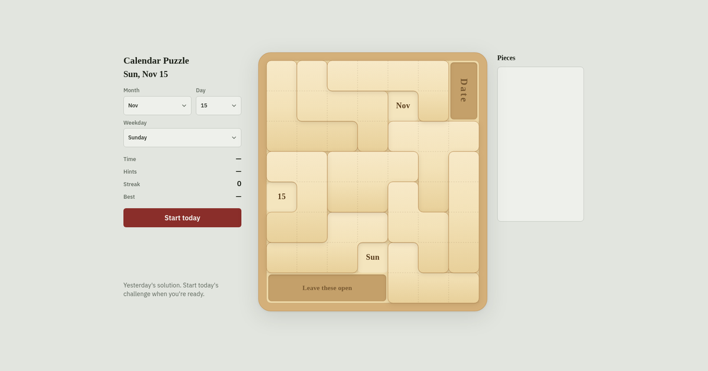

# Calendar Puzzle

A pure-frontend daily calendar polyomino puzzle. Leave the month, the day, and the weekday uncovered, then fit all ten pieces on the remaining 47 squares. Pieces may be rotated and flipped.

Play it online at [puzzle.buzuosheng.tech](https://puzzle.buzuosheng.tech).



This is an original web implementation of the well-known weekday (DOTY-style) calendar puzzle: an 8×7 board with 50 playable cells. It is not an official product of any commercial puzzle brand.

The current UI is English. A Chinese language version, a fuller mobile layout, and a per-solve share image are planned; see [Planned](#planned).

## How to run

```bash
npm install
npm test
npm run dev
npm run build
npm run preview
```

- `npm run dev` starts the Vite development server.
- `npm test` runs the Vitest suite (including a solvability check of all 2,562 month/day/weekday combinations).
- `npm run build` type-checks and writes a static site to `dist/`.
- `npm run preview` serves the production build locally.

## Rules

The board is a full regular 8×7 rectangle with 50 playable cells (12 months, 31 days, and 7 weekdays) and 6 unused cells. Unused cells are not notched out of the plate; they stay unplayable and are marked with darker recessed plaques: a vertical **Date** plaque in the top-right unused region, and **Leave these open** across the unused cells on the bottom row.

```
Jan Feb Mar Apr May Jun  .
Jul Aug Sep Oct Nov Dec  .
 1   2   3   4   5   6   7
 8   9  10  11  12  13  14
15  16  17  18  19  20  21
22  23  24  25  26  27  28
29  30  31 Sun Mon Tue Wed
 .   .   .   .  Thu Fri Sat
```

For a chosen month, day, and weekday, those three cells stay uncovered. Place all 10 pieces so they cover the other 47 cells, do not overlap, and do not cover unused cells or the three date cells.

On load, the board shows yesterday’s complete canonical solution in a locked preview, using the player’s local timezone (1 January wraps to 31 December). **Start today**, or changing the date picker, begins a fresh play for today or that date. The **Today** control is hidden during the preview; once play has started, it sits beside the date heading so you can jump back to today from another date. Dates use the local weekday (`Date#getDay()`, Sunday = 0). The date picker can load any month/day/weekday, including 29 Feb.

If you have already started or finished a puzzle, a refresh restores that board, the timer, and the hint count from `localStorage` instead of returning to yesterday’s preview. The undo stack is still not persisted. Preview mode does not write a session.

Playable dates are reflected in the URL as `?m=11&d=16&w=1` (month, day, and weekday). A link like `?date=2026-11-16` also works: it uses that local calendar date’s month, day, and weekday. The preview keeps a clean `/` with no query string. Changing the date updates the URL with `replaceState`, so you can share the current puzzle by copying the address.

## Piece set

Seven pentominoes (`V`, `T`, `Z`, `L`, `N`, `P`, `U`) and three tetrominoes (`J`, `S`, `I`). `#` is a filled cell. Pieces may be rotated in 90° steps and flipped. All pieces share the same light maple finish and are distinguished by shape.

```
V      T      Z      L
#..    ###    ##.    ##
#..    .#.    .#.    #.
###    .#.    .##    #.
                     #.

N      P      U      J
#.     ##     ##     ##
##     ##     #.     #.
.#     #.     ##     #.
.#

S      I
#.     #
##     #
.#     #
       #
```

This set is known to have at least one solution for every one of the 366 × 7 = **2,562** valid month/day/weekday combinations, including 29 Feb. The test suite asserts existence for all 2,562. Invalid days (for example 31 Apr) are skipped.

## Controls

- Drag a piece from the tray onto the board. It snaps to the grid. Illegal placements (overlap, off-board, unused cell, or date cell) are rejected and not committed.
- Click a piece to select it. Click it again, press **R**, or use **Rotate** to turn it 90° clockwise. Press **F** or **Flip** to mirror it. If a rotation or flip on the board no longer fits, the piece returns to the tray.
- **H** or **Hint** places one piece toward the canonical solution for the current date (or returns a blocking piece if needed). Repeated hints can finish the puzzle.
- **Undo** or **Ctrl+Z** / **Cmd+Z** reverts the last committed change (a successful placement, a return to the tray, rotate, flip, or hint, including a hint that returns a blocker). The shortcut is ignored when the focus is in a date select, when only **Z** is pressed, or when the board is locked. Undo restores piece positions, selection, and `hintsUsed`. It does not rewind the timer, date, mode, streak, or best times, and the undo stack is not persisted. Reset, Start today, and changing the date clear the stack. After a solve, Undo is disabled, so a persisted win is never un-saved.
- **Esc** deselects. **Reset** returns every piece to the tray and restarts the timer for the same date.
- The timer starts on the first successful placement, or the first rotate/flip, after load or reset. It stops when the puzzle is solved.

## Layout

On a desktop window (900px and up) the controls sit in a left sidebar (title, date heading and Today, month/day on one row and weekday below, stats, and actions) and the board plus a narrower piece tray sit on the right. The layout is meant to fit on one screen, including a typical 16-inch laptop viewport.

On narrower screens the same controls are compacted at the top. As soon as the width can fit a readable board beside a narrow tray (from about 600px, and in landscape when height is limited), the play area is board | tray. The current portrait-phone layout may still need a little vertical scrolling; a fuller mobile adaptation is planned (see [Planned](#planned)). There is no horizontal page scroll at 375×667 or typical phone widths.

Progress is stored only in `localStorage` under the key prefix `calendar-puzzle:` (the current play session, daily streak, last solved local date, and best time plus hint count per month/day/weekday). A solve counts toward the daily streak only when the puzzle’s month, day, and weekday all match the real local today. Best times are keyed with the weekday (for example `11-15-0`). Older month/day-only keys from the previous 7×7 game are left in place and ignored. There is no account and no backend.

## Solver and hint search order

The solver is a bitboard backtracker that runs entirely in the browser. A first solution for any combination is found in well under a second.

Hints always use the **first** solution found under this fixed order, so the same month/day/weekday always points at the same arrangement:

1. Always cover the lowest-index remaining cell (`index = row * 7 + col`, row-major, top-left first).
2. Try pieces in the order `V`, `T`, `Z`, `L`, `N`, `P`, `U`, `J`, `S`, `I`.
3. For each piece, try precomputed placements that cover that cell, in generation order: unique orientations (unflipped then flipped; for each, rotations 0°, 90°, 180°, 270° clockwise, first-seen only), and for each orientation, origins in row-major order.

## Planned

These items are not in the current build. Detailed decisions are locked in [REQUIREMENTS.md](REQUIREMENTS.md).

- **Chinese language version.** Add a complete Simplified Chinese UI (title, rules, buttons, board labels, plaques, and messages) with a visible English / 中文 switch. Remember the choice in `localStorage`. If there is no saved choice, default to the browser language (`zh*` → Chinese, otherwise English).
- **Mobile adaptation.** Fit the full game on a phone screen in portrait and landscape with no page scrolling at common sizes (including 375×667). Improve touch targets and piece dragging so every control stays usable; do not drop desktop features.
- **Per-solve share image.** After a solve, generate a card of this attempt (date, finished board, time, and hint count) that the player can save or share. This is separate from the fixed site preview image used for link previews.

## License

MIT. See [LICENSE](LICENSE).
